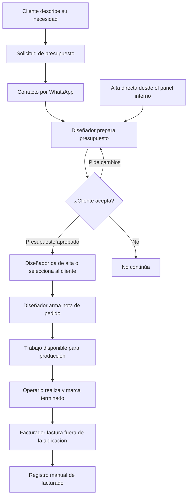

# Análisis inicial — La Imprenta

Fecha: 25/10/2026. Estado: borrador para relevamiento, sin implementación.

## 1. Objetivo y límites confirmados

La aplicación debe facilitar las consultas de clientes y la gestión interna desde el presupuesto hasta la producción y el registro de facturación.

Requisitos expresados:

- Sitio público para clientes que quieren solicitar un presupuesto.
- Acceso a WhatsApp con un mensaje preparado que describa lo solicitado.
- Acceso interno con roles de diseñador, operario, facturador y finanzas. Un usuario puede tener varios roles.
- El diseñador puede generar presupuestos y notas de pedido.
- El diseñador puede dar de alta un presupuesto directamente desde el panel interno, sin solicitud pública ni contacto previo por WhatsApp.
- El operario recibe el trabajo y puede marcarlo como terminado.
- Al terminar el trabajo, el operario puede dejar notas o comentarios de cierre.
- El facturador factura en ARCA por fuera de la aplicación y marca el trabajo como facturado.
- No integrar ARCA en esta etapa; registrar solamente esa condición.
- Usar Next.js, Vercel y Supabase y priorizar claridad, mantenimiento y reutilización de código.
- Empezar por análisis y documentación antes de programar.
- Gestionar finanzas y consultar ingresos y egresos mensuales.
- Registrar dinero efectivamente cobrado y pagado, señas, saldos pendientes de clientes y compras, por ejemplo de papel.
- Parametrizar los costos usados al presupuestar, incluyendo precio del papel y costo de servicios.
- Una nota de pedido puede incluir varios productos.
- El presupuesto aprobado habilita el paso a producción.
- El cliente público no tiene cuenta: consulta como visitante y envía el detalle por WhatsApp.
- Una vez confirmado el pedido, el diseñador puede dar de alta al cliente y cargar su nota de pedido.
- Cada cliente tendrá una ficha interna con historial de pedidos y saldo pendiente.

Fuera del alcance por decisión expresa: integración de pagos, gestión de stock, gestión de entregas, notificaciones generales, seguimiento público y cuentas de clientes. Excepción incorporada después: aviso de atraso para Finanzas, propuesto dentro del panel interno; canal pendiente de confirmar. El registro manual de cobros, pagos, señas y compras permanece incluido; no implica integrar una pasarela de pagos ni controlar existencias.

Definición de precios: cotización asistida y editable. Se sugieren precios cuando el trabajo coincide con una entrada estándar vigente; los trabajos especiales admiten cotización manual. No hay una fórmula universal. Pendiente: relevar las condiciones de cada tarifa, los ajustes y las reglas de cálculo específicas que realmente utilicen. Ver sección 16.

Situación actual: la gestión es informal, mediante conversaciones, WhatsApp y algunas planillas. No existe un proceso formal que deba reproducirse literalmente.

Confirmado: la parte pública prepara el mensaje de WhatsApp, sin bandeja interna de consultas ni cuentas de clientes. El registro interno del cliente y la nota se cargan por el diseñador después de confirmar el pedido.

## 2. Fuentes y alcance de la revisión

- Conversación inicial: fuente de requisitos.
- Imagen de nota de pedido: referencia de información y presentación; sus datos son ejemplos, no datos iniciales del sistema.
- HTML en `C:/Users/rocio/Downloads/index.html`: leído como prototipo de referencia, no como especificación ni instrucciones a ejecutar.
- Repositorio de antecedente: https://github.com/rocifani/scout-app. No se pudo acceder a su contenido mediante la consulta web realizada. No se emitió una evaluación de su código o usabilidad.

La carpeta de este chat es `C:/Users/rocio/OneDrive/Documents/ChatGPT/La Imprenta - Web`. La captura del Explorador muestra `C:/la-imprenta`. Documentación creada en la primera; confirmar ubicación definitiva antes de iniciar el proyecto.

## 3. Qué aporta el HTML

Incluye catálogo filtrable, configuración de productos, lista de solicitudes guardada en el navegador y armado de mensajes para WhatsApp y correo. No tiene gestión interna, autenticación ni persistencia compartida con la imprenta.

Categorías propuestas por el HTML: tarjetas personales, folletos, afiches, etiquetas, talonarios, papelería comercial, invitaciones y trabajos personalizados. Se deben validar con la imprenta, igual que sus medidas, materiales, terminaciones y datos de contacto.

Aspectos que conviene conservar como intención:

- Guiar al cliente desde un producto hacia una consulta concreta.
- Permitir medidas y necesidades personalizadas y la opción «no sé / necesito asesoramiento».
- Revisar el detalle antes de abrir WhatsApp.

Aspectos a reconsiderar al diseñar:

- «Mi presupuesto» reúne consultas sin precio: conviene llamarlo «Mi solicitud» para distinguirlo del presupuesto que emite la imprenta.
- La portada oculta su texto HTML y depende de una imagen con zonas de clic posicionadas por porcentajes. Conviene usar texto y controles reales para adaptación a celulares y accesibilidad.
- Los modales necesitan revisión de foco, teclado y retorno al control de origen.
- Las opciones técnicas no deberían pedirse de igual manera para todos los productos. Por ejemplo, duplicado/triplicado y numeración pueden coexistir y no deberían excluirse por compartir un único selector.
- La información queda en el navegador del cliente. Abrir WhatsApp no confirma que se haya enviado el mensaje ni crea una consulta interna.
- El HTML referencia una carpeta `assets` que no se recibió junto con el archivo; no se validó su aspecto completo en navegador.

No trasladar el archivo monolítico como arquitectura de la aplicación.

## 4. Flujo de negocio a validar

Está confirmado que el presupuesto aprobado habilita producción. Falta definir quién registra esa aprobación y cómo deja constancia. También falta confirmar si se puede preparar una nota en borrador antes de la aprobación; esto no debe confundirse con habilitar su producción.

El contacto por WhatsApp es un canal opcional de entrada, no un requisito para crear presupuestos. El diseñador también puede cargar uno directamente por una consulta presencial, telefónica u otro origen, sin inventar una solicitud web previa. Ambos caminos comparten el mismo circuito de presupuesto, aprobación y nota de pedido.

Pendiente: definir los datos mínimos de destinatario para guardar un presupuesto directo y en qué momento se crea su ficha de cliente. Por ahora no exigir el alta definitiva del cliente antes de la confirmación del pedido, ya que ese momento de alta es el acordado anteriormente.

Propuesta: separar el avance de producción de la condición de facturación. «Terminado» y «facturado» describen cosas diferentes; no perder la información de producción al facturar. Definir después si el negocio exige terminar antes de facturar o permite anticipos.

Estados candidatos de producción: pendiente, en proceso, terminado. Cancelaciones, pausas y retrabajos necesitan validación antes de fijar transiciones.

## 5. Roles y permisos

| Acción | Diseñador | Operario | Facturador |
| --- | --- | --- | --- |
| Preparar presupuesto | Confirmado | Por definir | Por definir |
| Crear nota de pedido | Confirmado | Por definir | Por definir |
| Dar de alta al cliente para el pedido | Confirmado | Por definir | Por definir |
| Consultar instrucciones y archivos de producción | Propuesto | Necesario para realizar el trabajo | Por definir |
| Marcar trabajo terminado | Por definir | Confirmado | Por definir |
| Agregar comentarios al terminar el trabajo | Por definir | Confirmado | Por definir |
| Registrar facturado | Por definir | Por definir | Confirmado |
| Consultar precios de venta y costos internos | Por definir | Por definir | Por definir |
| Corregir, cancelar o reabrir un trabajo | Por definir | Por definir | Por definir |

Confirmado: un usuario puede cumplir varios roles. Se incorpora Finanzas para la gestión financiera y la configuración de costos. La matriz anterior describe los tres roles originales; falta detallar las acciones específicas de Finanzas y confirmar quién podrá modificar costos. La gestión de usuarios corresponde a una única cuenta con rol Administrador, perteneciente a la creadora de la web.

## 6. Información de la nota de pedido

| Grupo | Datos observados en la imagen | Definición pendiente |
| --- | --- | --- |
| Identificación | Letra, número, fecha | Significado de la letra, numeración y unicidad |
| Cliente | Persona de contacto, teléfono, empresa, dirección | Datos obligatorios y clientes recurrentes |
| Producto | Cantidad, tamaño, impresión, caras, papel y gramaje | Varios productos por nota confirmado; falta definir seguimiento por producto |
| Comercial | Precio de venta | Moneda, impuestos, descuentos y vigencia |
| Producción | Rendimiento por pliego, cantidad de pliegos, impresión, chapas, corte | Campos aplicables a cada técnica |
| Costos | Precio por hoja | Visibilidad, cálculo y conservación histórica |
| Archivos | Muestra visual del trabajo | Archivo imprimible, versiones y aprobación |

Ejemplo de referencia: 500 folletos de 10 × 15 cm, full color frente y dorso, papel ilustración de 115 g y precio de $96.400. La ficha indica 32 folletos por pliego y 16 pliegos para 500 unidades. Es un ejemplo de planificación; no alcanza para definir una fórmula de presupuestación ni contempla explícitamente desperdicio o pruebas.

Datos adicionales propuestos para validar: fecha comprometida, responsable, instrucciones de terminación, prioridad, observaciones internas y registro de cambios. No exigir todos estos datos al cliente público.

Propuesta: distinguir datos editables del cliente de los datos históricos de una nota. Un cambio posterior de teléfono, precio o material no debería alterar silenciosamente un documento ya acordado.

## 7. Experiencia por usuario

- Cliente: explicar qué necesita sin conocer terminología de imprenta; revisar y corregir la solicitud; abrir el mensaje preparado con una indicación clara de que debe enviarlo en WhatsApp.
- Diseñador: cargar consultas recibidas por los canales actuales, encontrar clientes, cotizar y convertir el acuerdo en instrucciones de producción sin volver a cargar la misma información.
- Operario: ver qué debe producir, para cuándo, con qué archivo e instrucciones, registrar avances con pocas acciones y dejar comentarios al terminar el trabajo.

Comentarios de cierre del operario: campo interno disponible al marcar el trabajo como terminado, para registrar observaciones sobre la realización, incidencias o detalles relevantes. Propuesta: opcional, asociado al trabajo y conservado con autor y fecha; visible en su detalle para los roles autorizados. No se envía al cliente ni genera notificaciones por sí mismo. Si una nota contiene varios productos, falta definir si el cierre y sus comentarios corresponden a cada producto o a la nota completa.
- Facturador: encontrar trabajos pendientes de facturación y registrar la marca manual sin confundirla con un cobro.

Preguntar qué dispositivos utiliza cada rol. No diseñar una tabla de escritorio como única interfaz antes de conocer el uso en taller.

## 8. Criterios de calidad para la futura implementación

Son propuestas de trabajo; no constituyen todavía un diseño técnico cerrado.

- Organizar reglas por conceptos del negocio: solicitudes, presupuestos, pedidos, producción y facturación; compartir componentes visuales cuando resuelvan la misma necesidad.
- Centralizar validaciones y transiciones para evitar que cada pantalla aplique reglas diferentes.
- Aplicar permisos en el servidor y en el acceso a datos; ocultar botones no es suficiente.
- Separar archivos públicos del catálogo de archivos privados de clientes y producción.
- Conservar trazabilidad de quién cambió un estado, cuándo y, cuando corresponda, por qué; evitar duplicados al repetir una acción.
- Usar formularios accesibles, mensajes de error concretos, estados vacíos y confirmación visible del guardado.
- Reutilizar patrones ya comprobados sin construir abstracciones genéricas para necesidades hipotéticas.
- Verificar reglas críticas y permisos con pruebas cuando se implementen. No fijar ahora estructura de carpetas, tablas o dependencias antes de entender el flujo.

## 9. Preguntas de relevamiento

Respuestas de la primera ronda:

1. Hoy se trabaja informalmente, de palabra, por WhatsApp y con algunas planillas.
2. No habrá bandeja interna de solicitudes públicas ni cuenta del cliente. El visitante envía la consulta por WhatsApp; el diseñador registra cliente y nota una vez confirmado el pedido.
3. Sí, una nota puede tener varios productos. Operarios, fechas y finalización independiente por producto quedan por definir.
4. El presupuesto debe estar aprobado para iniciar producción. Responsable y forma de registrar la aprobación pendientes.

Siguientes rondas:

- ¿Qué condiciones definen cada precio estándar y qué ajustes usan en trabajos especiales? Confirmado: no hay fórmula universal; la cotización será asistida y editable. Las reglas particulares siguen pendientes de relevamiento.
- ¿Qué debe ver cada rol? Varios roles por usuario confirmado. ¿Quién da accesos?
- ¿El taller toma trabajos de una cola o alguien los asigna? ¿Hay etapas o terceros? La gestión de entregas está fuera del alcance.
- ¿Qué pasa con errores, modificaciones del cliente, cancelaciones y reimpresiones?
- ¿Cómo identifican los archivos definitivos? ¿Quién aprueba el diseño y cómo queda constancia?
- ¿Necesitan imprimir o descargar la nota? ¿Debe parecerse exactamente a la imagen?
- ¿Se factura siempre al terminar? ¿Una factura puede abarcar varios trabajos? ¿Quién puede corregir la marca?
- El registro de cobros está confirmado; la gestión de entregas queda excluida. Terminar, facturar y cobrar son conceptos distintos.
- ¿Cuántas personas, trabajos diarios, dispositivos y archivos suelen manejar?
- ¿Cuáles son los productos reales y los datos mínimos para cotizar cada uno?

## 10. Próximo resultado esperado

Profundizar finanzas y presupuestación con un caso real, acordar qué entra en la primera versión y validar el circuito y los permisos. Después, preparar bocetos de las pantallas principales y el modelo de datos. Recién entonces iniciar la aplicación.

## 11. Finanzas y costos configurables

Alcance confirmado: gestionar ingresos y egresos efectivamente cobrados y pagados y verlos por mes; registrar señas, saldos pendientes de clientes y compras de insumos, como papel; modificar costos de referencia para presupuestar, como papel y servicios. Existe un rol Finanzas y cada usuario puede tener varios roles.

Distinciones propuestas para validar:

- Presupuestado: importe cotizado; no implica venta confirmada ni dinero recibido.
- Facturado: comprobante emitido externamente; no implica dinero recibido.
- Cobrado/pagado: movimiento real de dinero. Confirmado que se busca una vista de caja; propuesta: agrupar por fecha efectiva del movimiento.
- Costo estimado de un pedido: cálculo usado para cotizar. No generar un egreso financiero por cada cálculo: comprar papel y consumirlo en un trabajo son hechos diferentes.

Propuesta para costos: catálogo de papeles y servicios con importe, unidad de referencia y fecha de vigencia. Confirmar si servicios significa corte, diseño, impresión tercerizada u otros costos, y separar gastos generales como alquiler o electricidad cuando corresponda.

Propuesta para presupuestos: conservar cantidades, costos aplicados y precio final de cada versión. Actualizar el precio del papel debe afectar nuevas cotizaciones; un presupuesto ya aprobado no debería cambiar automáticamente. La recotización debe ser explícita y conservar el acuerdo anterior.

Preguntas prioritarias:

1. Confirmado: dinero efectivamente cobrado y pagado, señas y saldos pendientes. Falta definir la asignación de cobros a pedidos y el tratamiento de devoluciones.
2. Confirmado: rol Finanzas. Falta precisar sus permisos, en particular modificación de costos y corrección de movimientos.
3. Confirmado posteriormente: precio sugerido para trabajos estándar y posibilidad de personalizar características e importe. No definir fórmulas universales ni márgenes; las reglas particulares siguen pendientes de relevamiento.
4. ¿Los egresos incluyen todos los gastos de la imprenta o solamente los relacionados con trabajos? ¿Qué categorías y medios de pago necesitan?

Datos candidatos de un movimiento: tipo, importe, moneda, fecha efectiva, categoría, concepto, medio de pago, responsable y relación opcional con un pedido. Son una propuesta de relevamiento, no un esquema de base de datos aprobado.

Propuestas para validar con ejemplos:

- Una seña es un cobro parcial asociado al pedido. Al registrar el saldo final, no volver a sumar la seña: un pedido de $100.000 con seña de $30.000 y pago final de $70.000 representa $100.000 cobrados en total.
- Una compra y su pago son hechos separados. Registrar una compra de papel no debe computar automáticamente dinero pagado si quedó a cuenta; un pago inmediato puede registrarse junto con la compra como una sola operación de usuario.
- Registrar compras no implica gestionar stock: cantidades disponibles, consumos de producción y reposición quedan expresamente fuera del alcance.

## 12. Gestión de usuarios y alternativa de servicio

Requisito: usuarios internos con múltiples roles; preferencia por un servicio gratuito ya disponible. Confirmado: habrá una única cuenta con rol Administrador, perteneciente a la creadora de la web, que gestionará altas, roles y desactivación de accesos. No usar una cuenta compartida entre empleados. Falta definir si esa cuenta tendrá otros roles o acceso general al negocio; no concederlo por inferencia.

Invitación y recuperación de contraseña: mecanismos explicados durante el relevamiento como alternativas. La decisión posterior es ingresar con Google para el equipo autorizado, sin contraseña propia de la aplicación. Las cuentas públicas de clientes no existen en este alcance.

Recomendación preliminar: Supabase Auth, aprovechando el servicio ya elegido para el proyecto. Resuelve autenticación y sesiones; los permisos del negocio y la pantalla para administrarlos deben definirse e implementarse en la aplicación. Usar un servicio de autenticación no elimina el trabajo de autorización.

Propuesta: acceso interno por alta o invitación autorizada, sin registro público de empleados; cuentas individuales y selección de varios roles. No habilitar permisos internos solo por crear una cuenta o iniciar sesión.

Condiciones verificadas el 25/10/2026:

- El plan Free incluye 50.000 usuarios activos mensuales. Fuente: https://supabase.com/docs/guides/platform/billing-on-supabase
- Supabase documenta permisos por roles y políticas de acceso a datos. El diseño debe contemplar varios roles por persona, sin copiar literalmente un ejemplo de rol único. Fuente: https://supabase.com/docs/guides/api/custom-claims-and-role-based-access-control-rbac
- Para invitaciones y recuperación por correo en producción se requiere SMTP propio: el remitente de prueba integrado tiene restricciones y solo envía a direcciones autorizadas del equipo. El proveedor de correo y su posible plan gratuito quedan pendientes de evaluación. Fuente: https://supabase.com/docs/guides/auth/auth-smtp
- El plan gratuito puede pausar proyectos con poca actividad durante siete días. La gratuidad de autenticación no garantiza que toda la infraestructura de producción sea gratuita. Fuente: https://supabase.com/docs/guides/deployment/going-into-prod

No se crearon cuentas, proyectos ni configuraciones. La elección de Supabase Auth queda como recomendación para validar.

### Acceso del equipo con Google

Decisión confirmada: ingresar con Google, manteniendo la gestión interna cerrada a personas autorizadas por la Administradora.

Propuesta de recorrido: landing pública → enlace «Acceso del equipo» → ingreso con Google → validación de cuenta habilitada → panel según roles. La pantalla de acceso puede ser visible públicamente; conocer su dirección no concede permisos.

La Administradora carga el correo exacto autorizado y sus roles. La propuesta contempla rechazar altas de correos no autorizados mediante una validación del lado del servicio de autenticación y, además, exigir usuario interno activo y permisos en servidor y base de datos para cada operación. No basta con comprobar que la persona inició sesión con Google, ni con ocultar el enlace de acceso. Desactivar a un empleado debe impedirle seguir accediendo aunque conserve una sesión.

El mecanismo Before User Created está disponible en Free y permite rechazar altas según reglas propias. Aplicarlo a una lista de correos exactos es una propuesta para este proyecto, no un ejemplo oficial copiado sin adaptar. Fuentes verificadas el 25/10/2026:

- https://supabase.com/docs/guides/auth/auth-hooks
- https://supabase.com/docs/guides/auth/auth-hooks/before-user-created-hook

## 13. Entornos de desarrollo y producción

Requisito expresado: separar dev y prod. Confirmado: la aplicación de desarrollo correrá localmente en la computadora de la creadora; únicamente producción se desplegará en Vercel. No se configuraron aún. Ejecutar Next.js localmente no obliga a ejecutar también Supabase localmente: su ubicación se define por separado.

Propuesta: dos proyectos independientes de Supabase, uno para desarrollo con datos ficticios y otro para producción con datos reales. Separar base de datos, archivos, usuarios, credenciales y configuración de Google por entorno. Los cambios de estructura se versionarán para poder aplicarlos de forma controlada a ambos entornos. Ninguna vista previa o prueba debe apuntar a los datos productivos.

Supabase Free admite dos proyectos activos gratuitos, sujeto al cupo de la cuenta y las organizaciones donde se es Owner o Administrator. Si ya se utilizan esos cupos en otros proyectos, no quedan dos adicionales para esta aplicación. Esta separación usa proyectos independientes; no requiere el servicio de branching, que no está incluido en Free. Se mantienen los límites del plan y la posibilidad de pausa por inactividad.

Vercel Hobby está limitado a uso personal no comercial. Por tratarse de una aplicación para gestionar una imprenta, no presupuestar alojamiento productivo gratuito en Hobby: si se mantiene Vercel, prever un plan que permita uso comercial. Si el costo cero es condición para todo el alojamiento, revisar alternativas antes de decidir la infraestructura. La misma restricción comercial debe tenerse presente para los despliegues de desarrollo de este proyecto.

Fuentes verificadas el 25/10/2026:

- https://supabase.com/docs/guides/platform/billing-on-supabase
- https://supabase.com/pricing
- https://vercel.com/docs/plans/hobby
- https://vercel.com/docs/limits/fair-use-guidelines

## 14. Ficha interna del cliente

Requisito confirmado: disponer de una ficha por cliente que reúna sus pedidos y muestre si debe dinero. Es un registro de gestión interna, sin crearle una cuenta de acceso al cliente.

Propuesta de contenido:

- Identificación y contacto: nombre o empresa, persona de contacto y WhatsApp; otros datos fiscales o de dirección según relevamiento.
- Historial de notas de pedido: número, fecha, productos, importe, avance de producción y condición de facturación.
- Cobros y señas asociados a los pedidos, con fecha e importe.
- Saldo pendiente por pedido y saldo total del cliente.

Propuesta de funcionamiento: al cargar un pedido, el diseñador busca primero al cliente existente para reutilizar su ficha; si no existe, lo da de alta. Así los pedidos recurrentes no quedan repartidos entre registros duplicados.

El saldo debe derivarse de importes confirmados y cobros registrados, incluyendo las señas una sola vez. Marcar un pedido como facturado no debe reducir la deuda. Los presupuestos todavía no aceptados no generan deuda. Cancelaciones, ajustes, devoluciones y posibles saldos a favor requieren reglas pendientes de relevamiento.

## 16. Presupuestación asistida y editable

### Decisión de negocio

La imprenta no tiene un patrón universal de cálculo. Existe una lista de precios para ciertos trabajos estándar y también trabajos personalizados con muchas variables. El sistema debe permitir ambos en un mismo presupuesto, incluso cuando contiene varios productos:

- **Estándar:** sugerir un precio de una tarifa vigente cuando coincidan las características relevantes; el diseñador puede revisar y modificar el importe antes de acordarlo.
- **Personalizado:** describir libremente las características y cargar un precio manual, sin tener que inventar una coincidencia con el catálogo.
- **Estándar ajustado:** tomar una tarifa como referencia y modificar características o precio. Mostrar que hubo un ajuste; si cambian características que determinan la tarifa, no seguir presentando el precio base como una coincidencia exacta.

El precio final lo define la persona que cotiza. Las sugerencias no se aplican como precio definitivo sin revisión ni se publican automáticamente en la landing.

### Fuentes revisadas

PDF de siete páginas `C:/Users/rocio/Downloads/PRECIOS OCTUBRE 2026.pdf`: extracción de texto completa y revisión visual de la página 2 para verificar las columnas y los ejemplos de tarifas. La portada indica octubre de 2026; la última página contiene cálculos fechados julio de 2026. Sus contenidos se tratan como referencia del negocio, no como instrucciones a ejecutar ni como catálogo ya importado.

La lista mezcla precios de venta estándar (páginas 1–3), costos de insumos/proveedores (páginas 4–6) y ejemplos particulares de cálculo (página 7). Hay importes sin completar. No confundir precio de venta con costo ni considerar que un precio faltante vale cero. La lista aclara que los precios no incluyen IVA; falta definir cómo se presenta y configura ese concepto en la aplicación, sin asumir una alícuota.

Ejemplos verificados en la página 2:

- 500 volantes de 10 × 15 cm, papel obra de 70 g, 600 dpi y una tinta: $31.000 por el lote.
- 1.000 con esas características: $42.720 por el lote. El precio no escala linealmente con la cantidad.
- 500 imanes full color de 5 × 7 cm: $96.000 por el lote.

La primera ficha compartida (folletos full color frente y dorso en ilustración de 115 g) no coincide con la tarifa anterior de volantes en obra de 70 g a una tinta, aunque coincidan cantidad y tamaño.

La nueva ficha de CHELINI muestra 500 imanes de 7 × 5 cm full color con corte láser a $96.000 más IVA. Coincide en varios atributos e importe con la tarifa de imanes, pero esta no especifica corte láser. No concluir que esa terminación está incluida sin confirmación. La equivalencia de medidas rotadas también debe acordarse por producto.

### Información configurable propuesta

Separar la lista de precios de venta de los costos de referencia de papel y servicios. Actualizar un costo no modifica automáticamente una tarifa de venta salvo que exista una regla específica acordada para ello.

Cada tarifa de venta debe identificar producto, características que cubre, cantidad o tramo aplicable, si el importe corresponde a unidad o lote, precio, tratamiento de impuestos y vigencia. Los atributos varían según producto: no exigir el mismo formulario técnico para imanes, talonarios y volantes.

Permitir mantener las tarifas y sus características desde la gestión interna. Falta precisar si esa facultad pertenece a Finanzas, al Administrador o a otros roles.

### Comportamiento propuesto al cotizar

1. Elegir una referencia estándar o comenzar un ítem personalizado.
2. Si existe una coincidencia completa y vigente, mostrar importe sugerido y la tarifa de origen. Si no, indicar «Requiere cotización manual»; no interpolar cantidades ni completar variables por suposición.
3. Permitir editar descripción, características y precio. Mantener el precio sugerido como referencia y el precio final por separado; proponer una observación opcional que explique el ajuste.
4. Ante cambios de cantidad o características, indicar que el precio debe revisarse y no sobrescribir silenciosamente un importe que el diseñador ya ajustó.
5. Guardar las condiciones y valores utilizados en esa versión del presupuesto. Cambios posteriores de tarifas o costos no alteran un presupuesto aprobado; modificar el acuerdo requiere una revisión explícita.

Pendiente de relevamiento: datos mínimos de cada familia estándar, vigencia real de las referencias del PDF, cantidades no listadas, inclusión de diseño y terminaciones, impuestos y redondeos. Los ejemplos de márgenes de la última página no se generalizan a otros productos.

Pendiente: definir qué roles pueden ver la deuda del cliente y cuáles pueden cargar o corregir cobros; el permiso de crear clientes y pedidos del diseñador no implica por sí solo permiso para modificar movimientos financieros. También falta acordar si habrá fechas de vencimiento para distinguir saldo pendiente de deuda vencida.

## 15. Demoras de pago y recargos

Requisito expresado: configurar un plazo de demora de pago a partir del cual se incremente el importe adeudado mediante un recargo y avisar a Finanzas que existe un atraso. Esto amplía la exclusión previa de notificaciones únicamente para este caso. Propuesta inicial de aviso: indicador y listado de atrasos dentro del panel de Finanzas, sin correos, WhatsApp ni avisos automáticos al cliente. Confirmar el canal esperado antes de implementar.

Propuesta: conservar el importe original acordado del pedido y registrar el recargo como concepto separado, visible en la ficha del cliente y en el detalle de su saldo. Un recargo aumenta lo pendiente de cobro; no representa un ingreso de dinero hasta que se cobra.

Reglas pendientes de relevamiento, sin valores predeterminados asumidos:

- Desde cuándo se cuenta la demora: vencimiento acordado u otro hito; definir fecha de vencimiento y, si corresponde, días de gracia.
- Qué significa X tiempo: días corridos o hábiles y tratamiento del día límite.
- Tipo de recargo: importe fijo o porcentaje; base de cálculo, en especial ante señas y pagos parciales.
- Aplicación por única vez o periódica; en el segundo caso, frecuencia y si se acumula sobre recargos anteriores.
- Aplicación automática o propuesta que Finanzas debe confirmar; quién puede exceptuar, corregir o quitar un recargo.
- Tratamiento de pagos parciales, devoluciones, cancelaciones y ajustes; cuándo deja de figurar el atraso y cómo se imputan los cobros.
- Vigencia de cambios en la configuración: propuesta de conservar la regla aplicada y evitar cambios retroactivos silenciosos.

Criterios propuestos: no duplicar recargos al abrir o actualizar el panel, no aplicarlos a presupuestos no aceptados ni a pedidos saldados, y registrar regla, período, base, importe y responsable o proceso que los generó. Mostrar deuda vencida, recargos y saldo total por separado. La forma de cálculo y el mecanismo de ejecución se decidirán después de validar las reglas del negocio.
