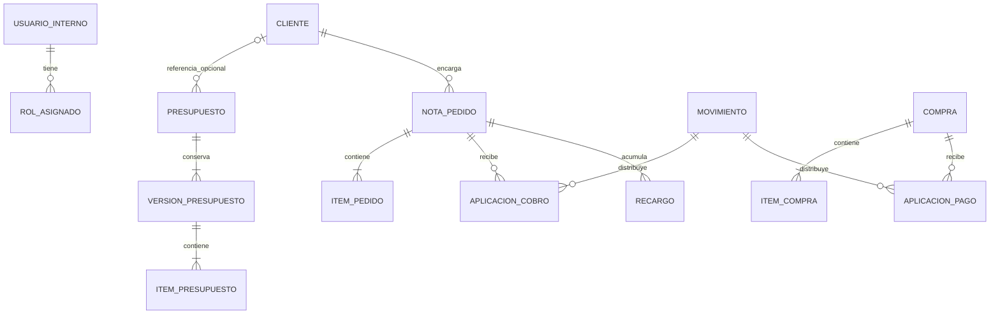

# Modelo de datos propuesto

Estado: acceso y gestión de usuarios implementados. También está implementado el primer [circuito comercial](clientes-presupuestos.md): clientes, presupuestos con versiones y trabajos y notas de pedido creadas directamente o desde presupuestos aprobados. Producción operativa permite terminar trabajos o cerrar la nota completa con comentarios. Tarifas y finanzas siguen pendientes; el registro manual de facturación está implementado. Las secciones siguientes describen el objetivo completo; consultar los documentos de cada entrega para distinguir implementación de propuesta.

## Criterio general

Separar identidad del equipo, clientes, acuerdos comerciales, producción y movimientos de dinero. Son conceptos relacionados, pero con ciclos de vida diferentes. Esta aplicación corresponde a una única imprenta; no se propone una plataforma para múltiples empresas.

Los clientes no tienen cuenta. Las consultas de la landing no se guardan en la base: generan un mensaje para WhatsApp. El equipo puede crear presupuestos directamente.

## 1. Equipo y acceso

| Registro | Responsabilidad |
| --- | --- |
| Identidad en Supabase Auth | Identificar a la persona que ingresó con Google; no concede permisos de negocio por sí sola |
| Usuarios internos | Vincular la identidad con nombre, correo autorizado y condición activa |
| Roles por usuario | Asociar uno o varios roles: diseñador, operario, facturador, finanzas y administrador |
| Autorizaciones de acceso | Guardar los correos exactos habilitados por la administradora antes del primer ingreso |

La cuenta Administrador será única y se inicializará de forma controlada. No podrá obtenerse por registro público ni por cambiar datos de perfil. Su permiso confirmado es gestionar usuarios; el acceso a otras funciones se concede mediante los roles correspondientes hasta acordar otra regla.

Las autorizaciones previas y los usuarios activos deben mantenerse coherentes: desactivar un usuario debe impedir tanto su acceso actual como una nueva habilitación involuntaria. Validar estado activo y roles en el servidor y en las políticas de acceso a datos (RLS). Los usuarios no pueden asignarse roles ni habilitarse a sí mismos. La landing no recibe permisos de lectura sobre datos internos.

## 2. Clientes y acuerdos

| Registro | Datos principales y relaciones |
| --- | --- |
| Clientes | Nombre o empresa, contacto, teléfono y observaciones; reúne varios pedidos |
| Presupuestos | Identificador, estado y vínculo opcional a cliente existente (implementado, con filtros por cliente y fecha de creación) |
| Versiones de presupuesto | Destinatario y cliente vinculado de cada versión, fecha, condiciones y autor; vigencia y recotizaciones posteriores a aprobación pendientes |
| Ítems de presupuesto | Varios trabajos por versión: descripción, cantidad, características, referencia de tarifa opcional, precio sugerido y precio cotizado |
| Notas de pedido | Cliente obligatorio, referencia a versión aprobada, número, fecha, compromiso de producción si se acuerda, condición de facturación y datos históricos del acuerdo |
| Ítems de pedido | Trabajos acordados e instrucciones de producción, conservados al crear el pedido |

El presupuesto puede existir antes del alta del cliente: conserva los datos del destinatario sin crearle una cuenta ni forzar una ficha definitiva. Una vez aprobado, el diseñador selecciona o crea al cliente y genera la nota. Registrar quién confirmó la aprobación y cuándo; queda pendiente cómo acredita esa aceptación.

Propuesta inicial: una versión aprobada origina una nota de pedido, mediante una operación que no duplique notas si se reintenta. Confirmar si necesitan dividir un presupuesto entre varias notas antes de fijar esta relación como restricción definitiva.

Una modificación de costos, tarifa o contacto no reescribe documentos históricos. La versión aprobada se conserva; cambios posteriores del acuerdo requieren revisión explícita.

## 3. Producción y archivos

| Registro | Responsabilidad |
| --- | --- |
| Avance de producción | Estado del trabajo y registros de quién lo cambió y cuándo |
| Comentarios de cierre | Observaciones internas del operario, con autor y fecha |
| Archivos de trabajo | Relación con el pedido, propósito y ubicación privada del archivo; distinguir muestra y archivo imprimible |

Confirmado: cada trabajo de la nota se termina por separado; el operario también puede terminar la nota completa. Cada ítem conserva su estado de producción. La acción «Terminar nota completa» termina todos los ítems que todavía no estén terminados, conservando los cierres ya registrados. Registrar los cambios de forma atómica y sin duplicarlos ante reintentos.

Propuesta: calcular el avance general de la nota a partir de sus ítems: pendiente si ninguno comenzó, en proceso si hay avance pero faltan trabajos por terminar, terminada cuando todos finalizaron. No permitir una nota terminada con ítems pendientes. Al terminar la nota completa, mostrar qué trabajos se van a cerrar y conservar autor y fecha de cada cierre.

Propuesta para comentarios: permitir notas de cierre opcionales por ítem y un comentario general opcional para el cierre conjunto, sin sobrescribir comentarios anteriores. Reaperturas, cancelaciones y retrabajos siguen pendientes de relevamiento.

Los archivos se guardarán en almacenamiento privado; la base guarda sus referencias y permisos.

Facturación permanece separada del avance de producción: inicialmente una marca manual por pedido con autor y fecha, sin integración con ARCA. No crear por anticipado un subsistema de facturas ni asumir que facturado significa cobrado.

## 4. Tarifas y costos

| Registro | Responsabilidad |
| --- | --- |
| Familias de trabajos | Organizar los trabajos de referencia sin impedir descripciones personalizadas |
| Tarifas estándar y sus versiones | Características cubiertas, cantidad aplicable, unidad o lote, importe, impuestos y vigencia |
| Costos de referencia y sus versiones | Papel, materiales y servicios, con unidad e importe de referencia |

Los precios acordados y las cantidades se guardan en campos explícitos. Las características técnicas variables pueden conservarse en un objeto estructurado validado por familia, junto con una descripción libre. No guardar todo el presupuesto como un único texto ni construir un motor genérico de reglas antes de conocer las familias reales.

No extrapolar cantidades no listadas ni tomar un atributo desconocido como coincidencia. Un ítem personalizado no necesita una tarifa asociada. Cambiar costos no recalcula automáticamente tarifas de venta.

## 5. Finanzas

| Registro | Responsabilidad |
| --- | --- |
| Movimientos de dinero | Ingreso o egreso real, importe, moneda, fecha efectiva, categoría, medio de pago, concepto y responsable |
| Aplicaciones de cobros | Relacionar importes cobrados con pedidos; permite identificar señas y evitar descontarlas dos veces |
| Compras e ítems de compra | Registrar la adquisición y su detalle, aunque todavía no esté pagada; cantidades de compra sin control de stock |
| Aplicaciones de pagos | Relacionar egresos con compras cuando corresponda; otros gastos pueden existir sin compra de insumos |
| Categorías y medios de pago | Clasificación configurable para la consulta mensual |
| Recargos y reglas versionadas | Agregar conceptos por atraso sin modificar silenciosamente el precio original |

Una seña se registra como ingreso aplicado a un pedido, no como un segundo tipo de dinero que vuelva a sumarse al total cobrado. Propuesta: admitir que un cobro se distribuya entre varios pedidos; la interfaz inicial puede aplicar cada cobro a uno solo. La suma aplicada nunca supera el cobro ni cruza clientes o monedas por accidente.

El saldo se calcula a partir del importe confirmado, recargos y cobros aplicados; no se mantiene como un número editable independiente. Ajustes, devoluciones y saldos a favor requieren definición antes de implementar sus efectos. El resumen mensual usa la fecha del movimiento efectivo, no la del presupuesto o la compra.

Comprar papel a cuenta no genera un egreso hasta registrar el pago. La aplicación no descuenta existencias ni calcula consumos de stock.

El aviso de atraso puede obtenerse de una consulta de saldos vencidos dentro del panel. El mecanismo de aplicación de recargos depende de las reglas pendientes; no asumir tareas automáticas, interés compuesto ni notificaciones externas.

## Relaciones principales

El diagrama omite relaciones pendientes y campos para facilitar la lectura. No es SQL definitivo.

## Integridad y desarrollo gradual

- Usar identificadores estables; la numeración comercial es un dato separado con una restricción de unicidad una vez relevada su regla.
- Importes con precisión decimal explícita y moneda, sin números de coma flotante para cálculos monetarios. Definir redondeos antes de implementar impuestos y recargos.
- Conservar fechas de negocio y marcas de tiempo; agrupar meses según la zona horaria acordada de la imprenta.
- Ejecutar aprobación, conversión a pedido y aplicación de cobros de forma atómica. Proteger contra reintentos que dupliquen operaciones.
- Historial de cambios sensibles; evitar borrar movimientos confirmados para corregirlos silenciosamente.
- Preparar migraciones SQL versionadas. Probarlas primero en dev, con datos ficticios, y después aplicarlas a prod. No crear a mano dos estructuras que puedan divergir.
- Primera migración: acceso, usuarios y roles. Siguiente entrega: clientes, presupuestos manuales y notas de pedido. Agregar finanzas y recargos cuando se implementen sus reglas.

Antes de la primera carga real deben quedar acordados los permisos de lectura de precios y deuda y las fechas de vencimiento. El avance de producción por trabajo y el cierre de nota completa ya están confirmados. Las definiciones pendientes no impiden comenzar la base de acceso.

Las notas directas requieren una ficha de cliente y trabajos con precios acordados. No requieren presupuesto: `orders.quote_id` y `quote_version_id` son opcionales y se conservan ambos nulos en ese caso. El alta atómica copia los datos del cliente y crea los trabajos pendientes, con la misma numeración y PDF que una nota originada en un presupuesto.

El estado visible de una nota se deriva de sus trabajos: Confirmada, Parcialmente terminada o Terminada. Facturada se muestra según la flag independiente, sin alterar el avance de producción. Ver [Producción](produccion.md) para permisos y reglas de cierre.
